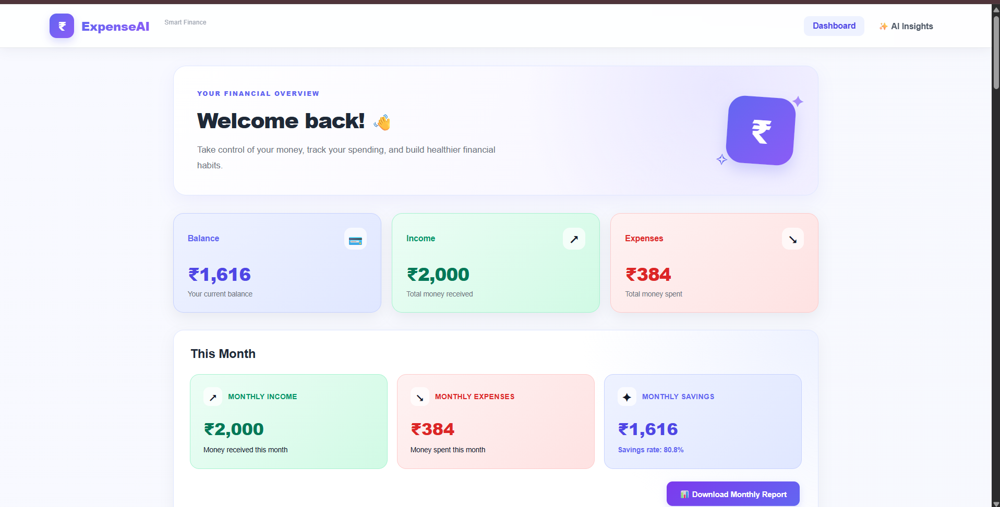
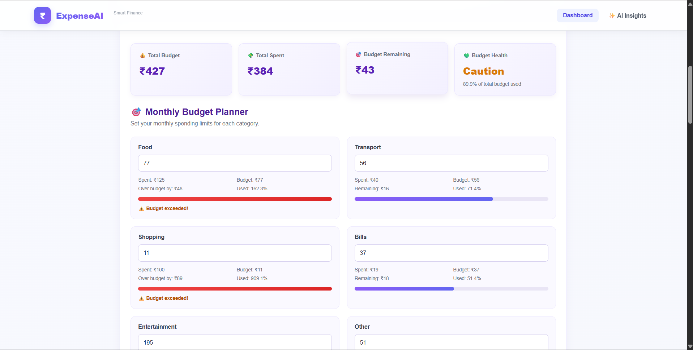
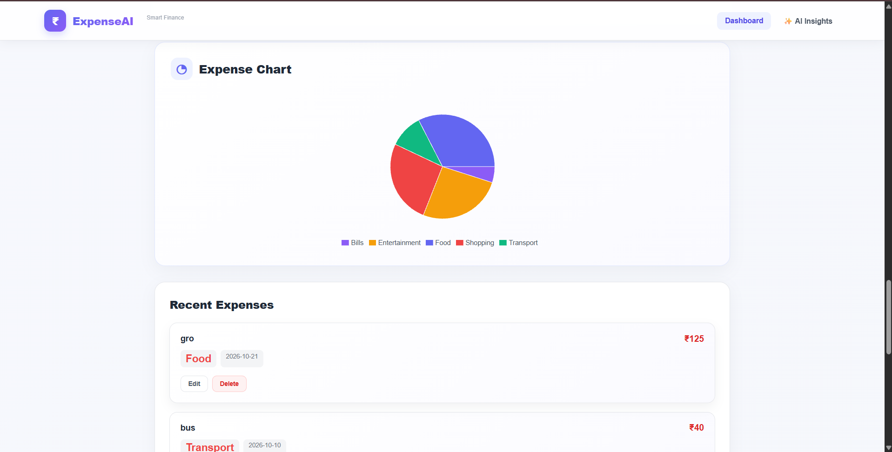

# ExpenseAI – AI-Powered Expense Tracker

ExpenseAI is a personal finance tracking application that helps users manage income, expenses, monthly budgets, and spending patterns through an interactive dashboard and AI-powered insights.

## Features

- Track income and expenses.
- Add, edit, and delete transactions.
- View balance, total income, and total expenses.
- Analyze spending by category using charts.
- Create monthly category budgets and monitor spending.
- View budget progress and budget warnings.
- Generate AI-powered financial insights using Google Gemini.
- Search and filter transactions.
- Export financial data to CSV.
- Store transaction data using localStorage.

## Project Screenshots

### 1. Dashboard

View your balance, income, expenses, and monthly savings.



### 2. Budget Planner

Set monthly category budgets and monitor spending with progress indicators.



### 3. Expense Analytics

Visualize spending patterns through category summaries and an expense chart.



## Technologies Used

### Frontend
- React
- JavaScript
- Vite
- CSS
- Recharts

### Backend
- Node.js
- Express.js
- Google Gemini API

## Getting Started

### Prerequisites

Install the following before running the project:

- Node.js
- npm
- A Google Gemini API key

### 1. Clone the repository

```bash
git clone https://github.com/Vithula-N/ExpenseAI.git
cd ExpenseAI